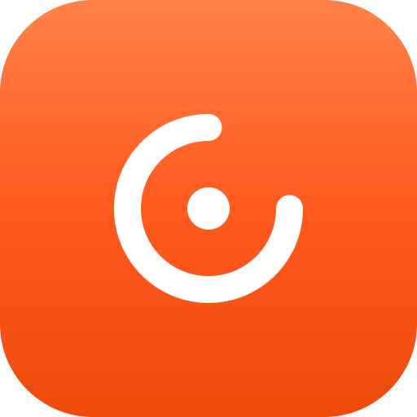
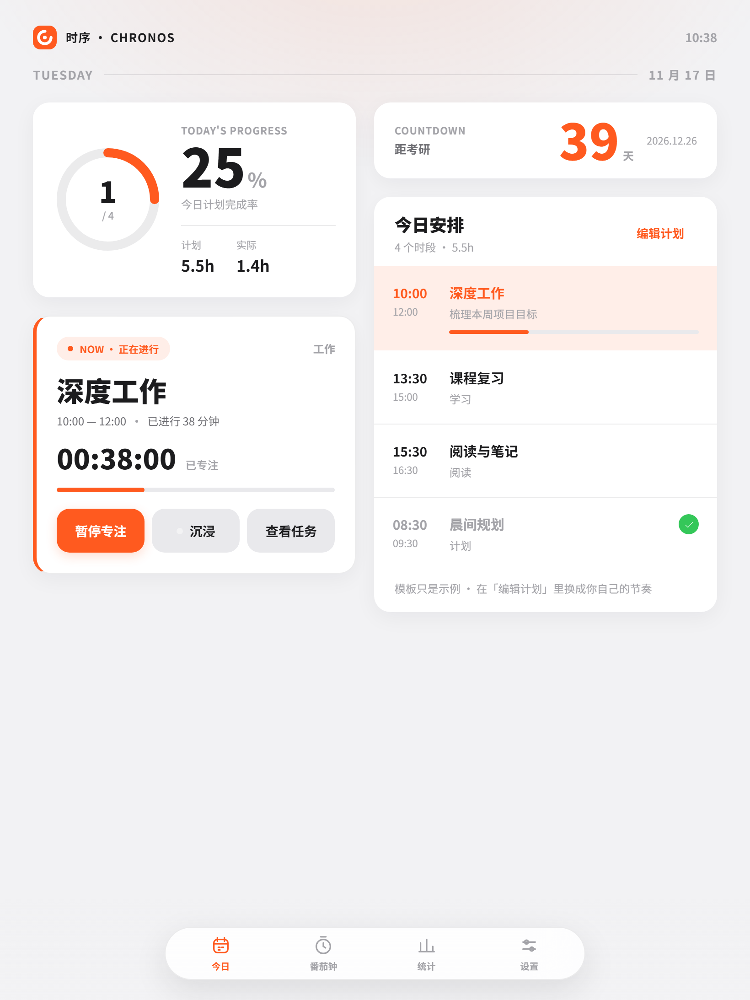
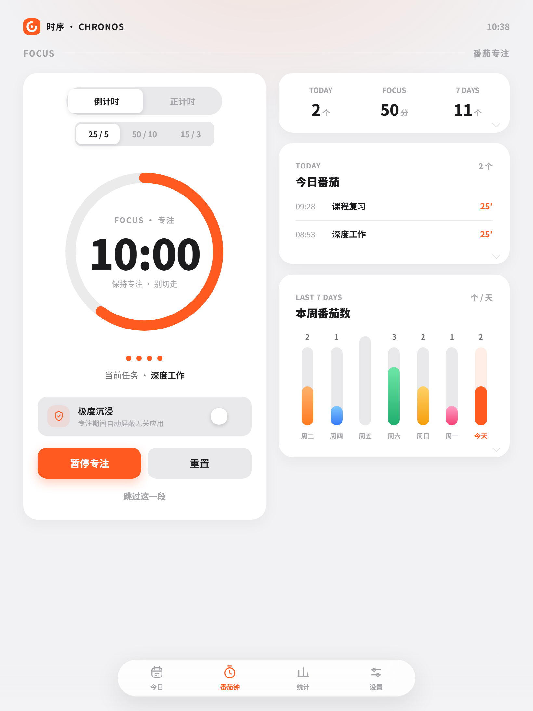
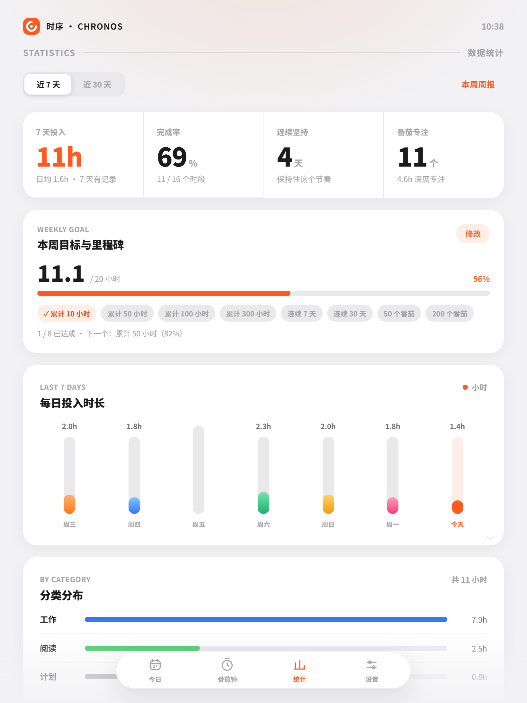
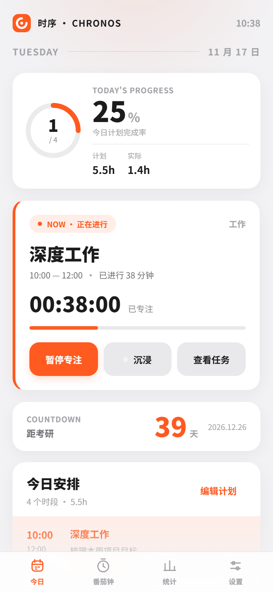
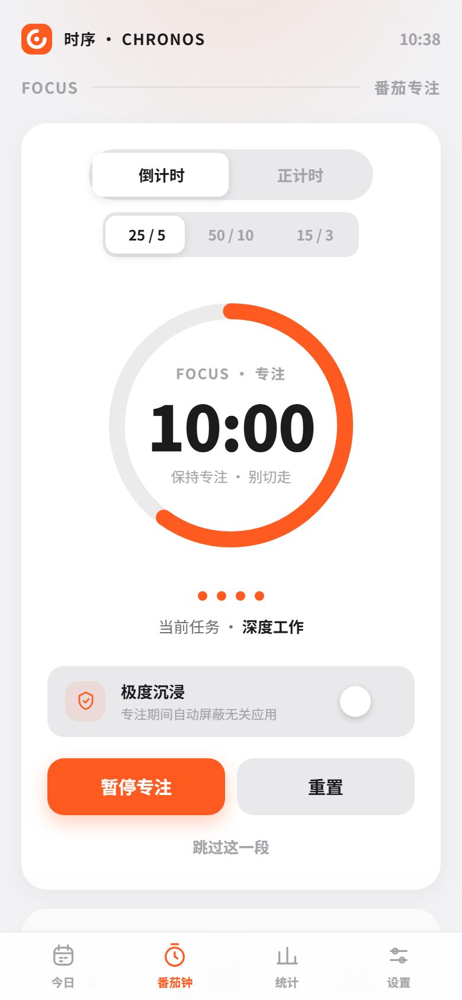
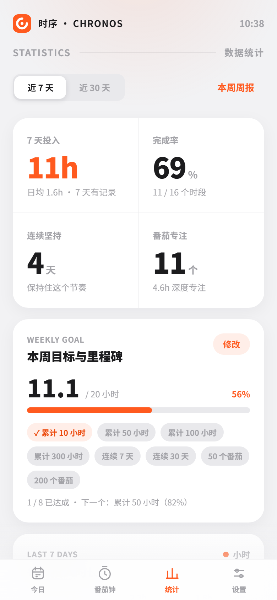

# Chronos

<div align="center">



<p><a href="README.md">简体中文</a></p>

### Give every moment a clear direction

A local-first time management app for study, work, and long-term goals. Plan your day, focus on the current block, and review your progress over time.

<p>
  <a href="https://github.com/Dvesiz/chronos/releases/download/v2.7.14/Chronos-2.7.14.apk"><strong>Download Android APK</strong></a>
  ·
  <a href="https://dvesiz.github.io/chronos/app/"><strong>Try in your browser</strong></a>
  ·
  <a href="https://dvesiz.github.io/chronos/"><strong>Product website</strong></a>
</p>

[](https://github.com/Dvesiz/chronos/releases/tag/v2.7.14)
[](https://github.com/Dvesiz/chronos/releases/latest)
[](https://github.com/Dvesiz/chronos/actions/workflows/pages.yml)
[](https://github.com/Dvesiz/chronos/actions/workflows/release.yml)
[](LICENSE)

</div>

<div align="center">

<p><strong>Tablet and desktop</strong></p>




<p><strong>Phone</strong></p>




</div>

## Product

Chronos is more than a to-do list. It organizes the day into actionable time blocks and connects planning, focus, tracking, and review:

```text
Plan  ->  Focus  ->  Track  ->  Review
```

- **Local-first:** Core planning, timers, and statistics work without an account or network connection.
- **Low distraction:** The interface keeps the current task in view and reveals detailed controls when needed.
- **Progress over time:** Daily effort, completion rates, check-ins, reviews, and goal progress stay visible.

## Features

### Daily planning

- Create a daily schedule from a reusable template.
- Delay, shorten, split, skip, resume, or add time blocks as your day changes.
- Carry unfinished tasks forward with a prompt to schedule them in an open slot.
- Record completed blocks, focus time, and streaks with daily check-ins.

### Focus

- Pomodoro countdown and count-up modes, with configurable durations and optional break transitions.
- Independent task timers with pause, resume, and accumulated focus time.
- A minimal focus view keeps the timer, current task, and essential controls on screen.
- Android Focus Guard can show an overlay when you leave Chronos. Alarms, calls, emergency calls, and permission prompts are allowed through.

### Statistics and reviews

- 7-day and 30-day trends, category breakdowns, completion rates, and plan comparisons.
- Monthly check-in calendar with daily effort levels.
- Daily reflections and shareable weekly summaries.
- Weekly goals, streaks, accumulated hours, and Pomodoro milestones.

### Android integration

- Minute-accurate schedule reminders rebuilt after reboot and time-zone changes.
- Start a focus session or snooze from notifications.
- 2×2 home-screen widget with daily progress, the next task, and a countdown.
- Countdown for exams, presentations, and project deadlines.
- Light, dark, and system-following themes; landscape layouts, safe areas, and responsive phone/tablet layouts.

## Platform support

| Capability | Android APK | Browser app |
|:---|:---:|:---:|
| Plans, templates, focus, statistics, check-ins, and reviews | Yes | Yes |
| JSON import and export | Yes | Yes |
| Local-first storage | Yes | Yes |
| Optional email sign-in and multi-device sync | Yes | Yes |
| System notifications and precise alarms | Yes | Browser-limited |
| Home-screen widget | Yes | N/A |
| Focus Guard and foreground service | Yes | N/A |

The browser app shares the APK's static UI and core logic. Install the Android APK for system notifications, precise alarms, widgets, or Focus Guard.

## Download and try

### Android APK

[Download Chronos 2.7.14](https://github.com/Dvesiz/chronos/releases/download/v2.7.14/Chronos-2.7.14.apk) · [All releases](https://github.com/Dvesiz/chronos/releases)

Android 8.0 or later is required. The APK is built without Gradle. When installing it from a file for the first time, allow your file manager to install unknown apps when Android prompts you.

### Browser app

[Open the browser app](https://dvesiz.github.io/chronos/app/) · [Product website](https://dvesiz.github.io/chronos/)

Browser data stays in the current browser. Export a JSON backup before clearing site data.

## Data and sync

### Local storage

The main application state uses IndexedDB (`chronos-state-v1`). If IndexedDB is unavailable or a write fails, Chronos falls back to `localStorage`; Android also keeps a native bridge backup. State loads and saves pass through schema migrations, currently at business schema v3.

JSON import and export remain available in the app. Import replaces the current state after saving a local backup. Uninstalling the app removes local data, so export a backup before changing devices.

### Optional cloud sync

After email verification, Chronos can sync plans, timers, statistics, and reviews between Android and the browser through Cloudflare Workers and D1. The sync protocol includes:

- Account-scoped events, queues, snapshots, and revision metadata.
- An IndexedDB Outbox (`chronos-sync-v1`) with a `localStorage` compatibility fallback.
- Revision checks and idempotency keys for concurrent submissions.
- Deletion tombstones to stop removed entities from returning from another device.
- Device cursors and safe event archival based on the slowest active device.
- Versioned snapshots with schema metadata and checksums.
- Per-event accepted, conflict, or rejected results; unresolved events remain on the device.
- Exponential retry after network errors without blocking offline use.

Sync is optional. Local plans, timers, statistics, and JSON backups continue to work when signed out, offline, or without an API configuration. API secrets stay in Worker secrets and are not included in the frontend, APK, or repository.

## Build from source

### Requirements

- JDK 11 or later; GitHub Actions uses JDK 17.
- Android SDK Platform 35.
- Android Build-Tools 35.0.0 or a compatible newer version.
- Git Bash, WSL, or another Bash environment for `build.sh`.
- Node.js 22 or later for tests and the Worker.

### Build the APK

```bash
git clone https://github.com/Dvesiz/chronos.git
cd chronos
./build.sh
```

The APK is written to `build/Chronos-x.x.x.apk`. Its version comes from `versionName` in `app/src/main/AndroidManifest.xml` and is copied into the frontend configuration during the build.

The default Android SDK path is `/opt/android-sdk`. Override it when needed:

```bash
ANDROID_SDK=/path/to/android-sdk \
ANDROID_BUILD_TOOLS=/path/to/build-tools/35.0.0 \
ANDROID_JAR=/path/to/platforms/android-35/android.jar \
./build.sh
```

The first build creates a local `keystore.jks` and `keystore.properties`; neither is committed. Keep the same signing key when publishing APK updates so Android can install them over existing copies.

### Run tests

```bash
cd backend
npm ci
npm run test:all
```

Tests cover frontend state migrations, primary IndexedDB storage, the sync Outbox, Web Locks, multi-tab sync, time and statistics logic, and Worker revision, idempotency, conflict, tombstone, device cursor, and archival behavior.

### Run the Worker locally

```bash
cd backend
npm run dev
```

See [`backend/README.md`](backend/README.md) for database migrations and deployment. Production APK releases use GitHub Actions: push a `v*` tag matching the manifest version to run tests, build a signed APK, and upload it to GitHub Releases.

## Project structure

```text
chronos/
├── app/src/main/
│   ├── assets/www/                 # Framework-free HTML, CSS, and JavaScript app
│   │   ├── app.js                  # State, planning, timers, statistics, and UI
│   │   ├── cloud-sync.js           # Optional account and sync client
│   │   ├── browser-adapter.js      # Browser-specific adapter
│   │   └── cloud-config.js         # Release API configuration
│   ├── java/com/dvesiz/chronos/    # Android WebView host and system integrations
│   └── res/                        # Icons, themes, notifications, and widget assets
├── backend/                        # Cloudflare Worker, D1 API, and migrations
├── site/                           # Product website
├── tests/                          # Frontend, sync protocol, and browser E2E tests
├── docs/img/                       # README screenshots and brand assets
├── build.sh                        # aapt2, javac, d8, zipalign, and apksigner
└── LICENSE
```

The app is built with native Java and WebView, without Gradle or a frontend framework runtime. The same core UI and logic are shared between the browser and Android app.

## Release notes

| Version | Highlights |
|:---|:---|
| **2.7.13** | Prevents stale startup state from replacing a running cloud timer; syncs task fields by stable ID; removes page headlines and adds system-following themes. |
| **2.7.12** | Forces snapshot reconciliation when the local sync cursor is stale, including manual sync, resume, and network recovery. |
| **2.7.10** | Fixes startup sync baselines and adds visible sync status with a manual sync action. |
| **2.7.9** | Recovers stuck queues from earlier versions and fixes startup reconciliation races. |
| **2.7.8** | Rebases and retries queued events after stale revision conflicts. |
| **2.7.7** | Adds Pomodoro count-up mode, tablet settings fixes, and schema v3 local persistence. |
| **2.7.0** | Adds email sign-in, multi-device sync, feedback, and release checks with Cloudflare Workers and D1. |
| **2.6.x** | Adds the browser app, data import/export, check-ins, reviews, goals, widgets, statistics, and Focus Guard. |
| **2.0.0** | Introduces the visual redesign and orange accent color. |
| **1.0.0** | First release with schedule templates, a timeline, focus timers, and system reminders. |

## Contributing

Report issues and suggestions through [GitHub Issues](https://github.com/Dvesiz/chronos/issues), or submit a Pull Request. Before submitting code, run `cd backend && npm run test:all`; UI changes should also be checked on phone and tablet layouts.

## License

Chronos is released under the [MIT License](LICENSE). You are welcome to use, study, modify, and distribute it.
