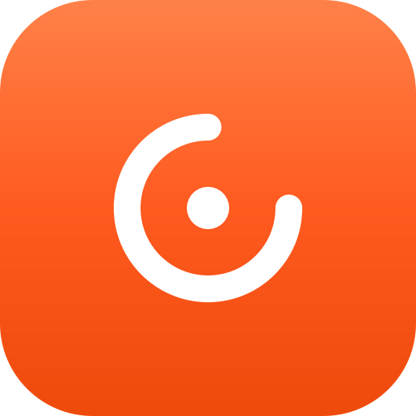
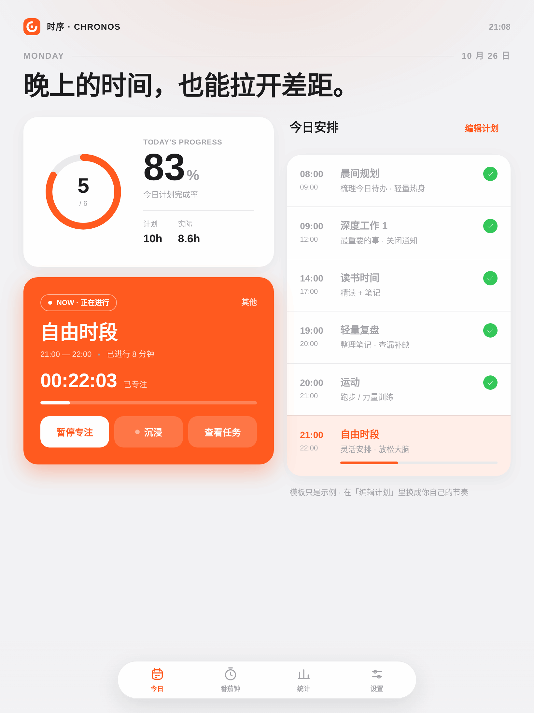
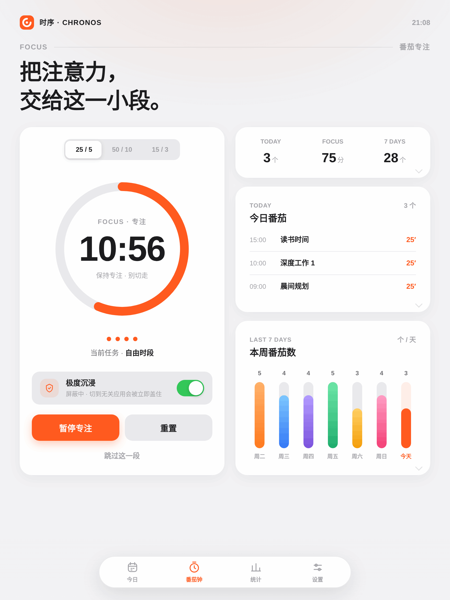
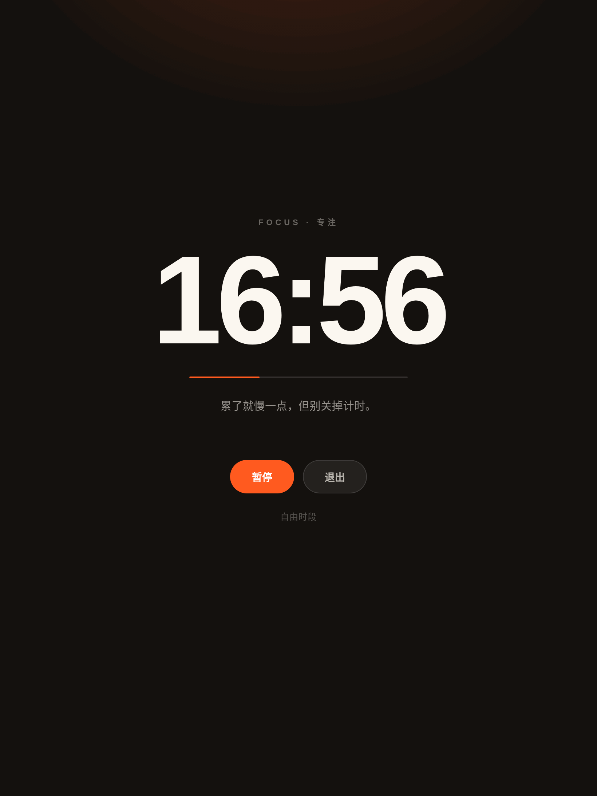
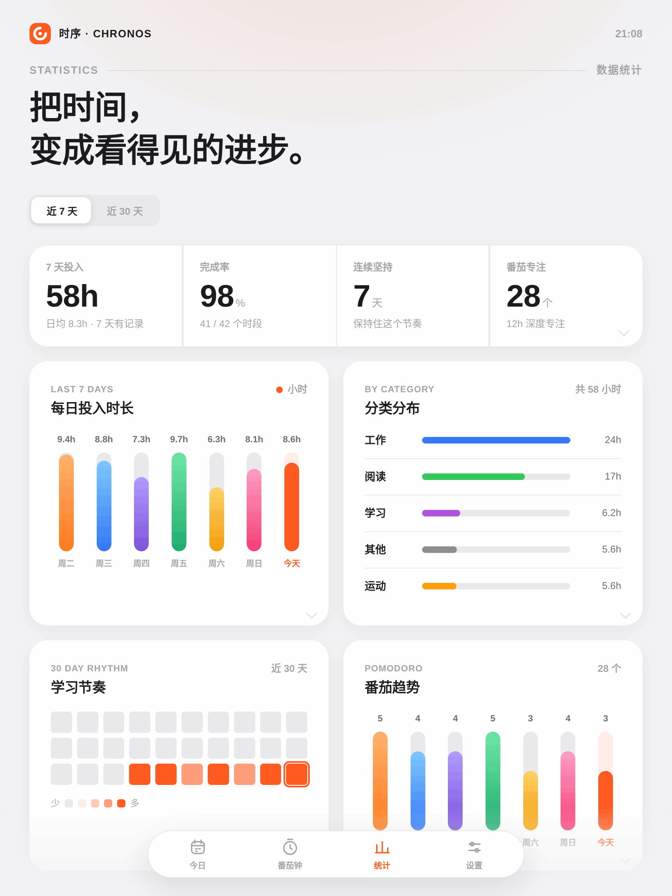
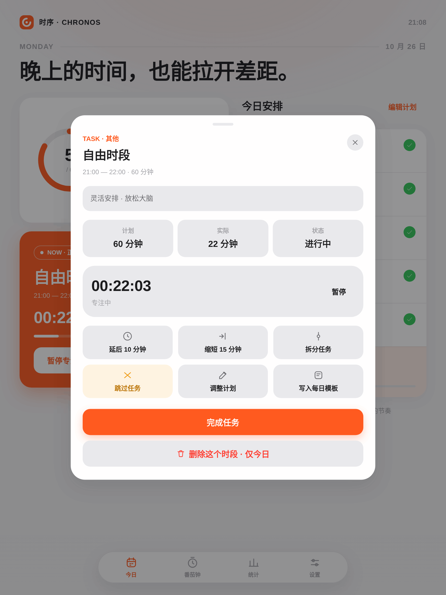
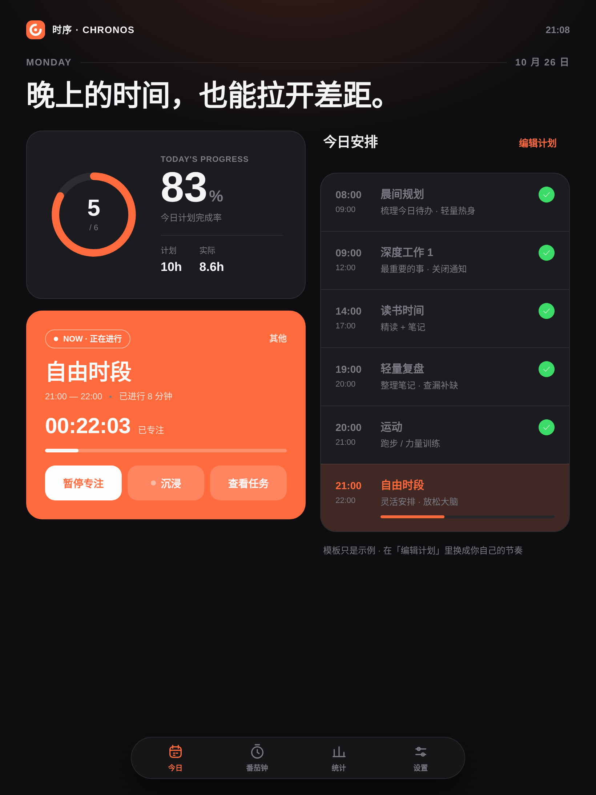

<div align="center">



# 时序 · Chronos

**让每一段时间，都有明确的方向。**

为考研冲刺打造的 Android 时间管理应用 —— 计划、专注、复盘，一个闭环。

[]()
[]()
[]()
[]()
[]()

**零框架 · 零依赖 · 无 Gradle —— 一条 build.sh 打包**

<br />

### 下载安装

[](https://github.com/Dvesiz/chronos/releases/latest/download/Chronos-2.6.7.apk)

**Android 8.0+** ｜ 约 110 KB ｜ 无后台联网、无账号、数据全部存在本机

下载后允许「安装未知来源应用」即可；全部版本见 [Releases](https://github.com/Dvesiz/chronos/releases)。

<br />

### 在线体验

[打开 Chronos 在线体验](https://dvesiz.github.io/chronos/)

浏览器版直接复用 APK 的界面与交互逻辑，计划、专注、番茄钟、统计、打卡、导入导出均在本地运行；系统通知、精确闹钟、悬浮窗和极度沉浸等 Android 能力请安装 APK。

| | | |
|:---:|:---:|:---:|
|  |  |  |
| **今日** · 时间轴与当前任务 | **番茄钟** · 节奏与沉浸开关 | **沉浸专注** · 只剩时间与一句话 |
|  |  |  |
| **统计** · 7 / 30 天复盘 | **任务详情** · 十种快捷操作 | **暗色模式** · 夜间自动适配 |

<sub>以上均为平板（820 × 1093）双栏布局实拍；手机端自动收成单栏。</sub>

</div>

---

## 设计哲学

考研冲刺的每一天都高度相似：同样的科目、同样的时段、同样的战斗。
**时序** 不做待办清单，而是把一天切成清晰的时段 ——
你只需要知道两件事：**现在该做什么，以及这一段做得怎么样。**

> **计划（Plan）→ 专注（Focus）→ 复盘（Review）**，每一天自动闭环。

## 功能特性

### 📅 每日计划
- **模板驱动** —— 配置一次作息模板（如 08:00 单词 / 09:00 数学 / 14:00 专业课…），每天自动生成日程
- **弹性调整** —— 临时有事？支持**延后 10 分钟 / 缩短 15 分钟 / 拆分任务 / 跳过**，一键应对
- **完成态补时** —— 标记完成后发现还没学完？点「继续」在已累计时长上继续计时
- **随时增删** —— 今日计划与每日模板均可新增、编辑、删除（删除带二次确认防误触）
- **遗留顺延** —— 没做完的任务不会凭空消失，第二天在计划卡里提示，可一键排进今天的空档
- **每日一句复盘** —— 晚上写一句话记下当天状态，周末自动汇总
- **每日打卡动效** —— 当天计划全部完成（完成或跳过）后弹出一张打卡卡：进度环填满、打勾、彩带与印章，可分享成果；每天只触发一次

### 🍅 沉浸专注
- **番茄钟** —— 经典 25/5 节奏，可自定义时长，支持自动衔接休息
- **极简专注界面** —— 开始番茄后铺满整屏：只剩时间、一句话和暂停 / 退出，入场逐层浮起，每 45 秒换一句
- **任务计时** —— 独立于番茄钟的纯专注计时，暂停 / 恢复 / 累计都在
- **首页速启** —— 进行中的橙色卡片里直接开始 / 暂停当前任务，一键开关沉浸
- **极度沉浸** —— 借「使用情况访问 + 悬浮窗」识别前台应用，切走即被全屏遮罩盖住（可一键回到 Chronos，长按 3 秒放弃本轮）
  - 番茄钟与任务计时都生效，到点由前台服务发结束通知，息屏也不丢
  - 闹钟 / 来电 / 紧急呼叫 / 授权弹窗自动放行

### 📊 数据统计
- **7 / 30 天**专注时长柱状趋势
- **学科分布** —— 数学 / 专业课 / 英语 / 政治投入一目了然
- **打卡日历** —— 月视图里同时看打卡与投入强度，点某一天能翻到当天的完成情况与复盘
- **完成率报告** —— 计划 vs 实际，诚实面对每一天
- **周报** —— 一键生成本周总结（投入、完成率、最高一天、复盘），可直接分享
- **周目标与里程碑** —— 本周目标进度条，累计 10 / 50 / 100 小时、连续 7 / 30 天、番茄数等成就

### 🔔 系统级体验
- **提醒通知** —— AlarmManager 精准到分钟的时段提醒，支持提前量设置，重启后自动重建
- **通知操作** —— 「开始专注」「稍后提醒」直接在通知栏完成，不用打开 App
- **桌面小组件** —— 2×2 显示今日进度、下一项任务与考试倒计时，点一下直接开始专注
- **考试倒计时** —— 首页显示「距考研 N 天」，日期与名称可自定义
- **数据备份** —— 保存为 JSON 文件 / 导入恢复；导入会覆盖当前数据，并先在本机留一份备份
- **深色模式** —— 一键切换 / 跟随系统
- **平板适配** —— 双栏布局、横屏优化、大屏等比放大，手机到平板一套代码

## 关于数据与账户

这是一个**纯单机**应用：没有服务器、没有云同步、不联网（`INTERNET` 权限仅为可选的验证码发信预留）。

- 学习数据存在 `localStorage`，并同步一份到 `SharedPreferences`（双保险，用于 WebView 存储被清时恢复）
- 「账户」是本机资料（昵称 / 头像 / 邮箱），验证码只在本机校验，**不是真实鉴权**，换机不会自动同步
- 卸载应用会一并清掉这两处数据，需要保留请先用「导出学习数据」；换机时在设置里「导入学习数据」即可恢复

## 快速开始

### 方式一：直接安装

前往 [Releases](../../releases) 下载最新 APK，安装即可（Android 8.0+，无需任何权限以外的配置）。

### 方式二：从源码构建

```bash
git clone https://github.com/Dvesiz/chronos.git
cd chronos
./build.sh
```

产物：`build/Chronos-x.x.x.apk`（自动签名，直接安装）

<details>
<summary><b>构建依赖</b>（点击展开）</summary>

| 依赖 | 版本 |
|:---|:---|
| JDK | 11+ |
| Android SDK Build-Tools | 35.0.0 |
| Android SDK Platform | android-35 |
| jar / keytool | 随 JDK |

将两者解压至 `/opt/android-sdk/build-tools/35.0.0` 与 `/opt/android-sdk/platforms/android-35`（或修改 `build.sh` 开头的路径变量）。

首次构建会自动生成签名密钥 `keystore.jks` 与口令文件 `keystore.properties`（两者均不入库）。
口令也可以用环境变量覆盖：`CHRONOS_KS_PASS=xxx ./build.sh`。
换机器构建时请把这两个文件一起带走 —— 用新密钥签出的 APK 无法覆盖安装旧版本；
若只有 `keystore.jks` 而缺 `keystore.properties`，构建会直接报错，不会另生成新钥。
</details>

## 技术架构

这个项目刻意做了一些**反潮流**的选择：

- **无 Gradle** —— 整个构建是不到 100 行的 `build.sh`：`aapt2 → javac → d8 → zipalign → apksigner`，一条链路，全透明
- **零依赖** —— 不用 React / Flutter / Compose，原生 `Java + WebView`，APK 约 100 KB
- **双保险持久化** —— `localStorage`（前端）与 `SharedPreferences`（原生）互为备份，WebView 存储被清也能恢复（卸载仍会清除，需自行导出）
- **时间戳驱动计时** —— 计时基于 `Date.now()` 差值而非 setInterval 累加，杀进程也不丢秒数

```
chronos/
├── app/src/main/
│   ├── AndroidManifest.xml
│   ├── assets/www/                   # 前端：无框架，纯 HTML/CSS/JS
│   │   ├── index.html
│   │   ├── styles.css                #   响应式 + CSS 变量主题系统
│   │   └── app.js                    #   状态机：计划 / 计时 / 统计
│   ├── java/com/dvesiz/chronos/
│   │   ├── MainActivity.java         # WebView 宿主 + JS 桥 + Edge-to-edge
│   │   ├── AlarmScheduler.java       # AlarmManager 提醒调度（全量重建 / 错过补发）
│   │   ├── ReminderReceiver.java     # 到点触发通知、通知「完成」回写
│   │   ├── NotificationHelper.java   # 通知渠道与操作按钮
│   │   ├── FocusGuardService.java    # 极度沉浸：前台服务 + 前台应用识别 + 遮罩
│   │   ├── LockPanel.java            # 锁定面板（全屏遮罩 UI）
│   │   ├── ChronosWidgetProvider.java # 2×2 桌面小组件（RemoteViews）
│   │   └── BootReceiver.java         # 开机 / 改时区后重建全部提醒
│   └── res/                          # 自适应图标 / 主题资源 / 小组件布局
├── build.sh                          # 一键构建：aapt2 + javac + d8 + apksigner
├── docs/img/                         # README 截图与 Logo
└── LICENSE
```

## 版本历史

| 版本 | 内容 |
|:---|:---|
| **2.6.7** | 导出改为系统「保存为」JSON 文件，不再导出文本分享；统计页重排，打卡日历移至顶端，月历旁新增打卡天数、投入时长、完成率与连续天数概览 |
| **2.6.7-web** | 新增 GitHub Pages 在线体验版：复用 APK 的静态界面和逻辑，浏览器本地保存数据，支持 JSON 文件下载与导入，系统级 Android 能力显示为浏览器说明 |
| **2.6.6** | 新增「导入学习数据」：从导出的 JSON 恢复（导入前本机留备份，覆盖前二次确认）；统计页把 30 天热力图换成「打卡日历」——月视图同时显示打卡与投入强度，可翻月、点某天看当天完成情况与复盘 |
| **2.6.5** | 每日打卡动效：当天计划全部完成（完成或跳过）后弹出打卡卡——进度环填满、打勾、彩带 + 印章动效，显示完成时段 / 专注时长 / 连续天数，可分享；每天只触发一次，设置里关掉动效则静态展示 |
| **2.6.4** | 统计页重排：去掉与总结重复的「深度分析」和与番茄页重复的「番茄趋势」，平板横屏改为 6 列栅格（3+3 / 4+2 / 2+4），不再留空洞；考试倒计时从星期下面移到「今日安排」上方，改成大号数字卡片；修复番茄钟「当前任务」一直停在旧任务的问题（空闲时跟随当前时段，重置 / 删除任务会解绑） |
| **2.6.3** | 新功能：未完成任务次日遗留提示与一键顺延；每日一句复盘 + 一键生成周报分享；首页考试倒计时；本周目标进度与里程碑（累计时长 / 连续天数 / 番茄数）；2×2 桌面小组件（今日进度、下一项、倒计时、一键开始） |
| **2.6.2** | 首页布局重排：「今日安排」标题收进卡片，平板两列卡片对齐同一条基线，卡片内边距与间距统一；小屏压缩进度卡，首屏就能看到今日安排。修复 Windows 版 aapt2 把 assets 写成反斜杠、WebView 报 `ERR_FILE_NOT_FOUND` 的问题（改用 jar 打包 assets） |
| **2.6.1** | 省电与流畅：息屏时暂停前台应用轮询；番茄页 / 统计页改为切页时按需渲染；闹钟按签名去重，不再每次保存全量重建。修复：键盘遮挡弹层表单、返回键直达退出、跨天未停的计时无限累加、跳过 / 删除任务不停表、完成态补时暂停后退回待开始、番茄与任务计时对同一任务重复计时、详情页日均口径不一致 |
| **2.6.0** | 番茄钟加入极简专注界面（全屏计时 + 激励语）；首页橙色卡片内置换开沉浸开关；首页移除番茄钟迷你卡；导航「专注」更名「番茄钟」 |
| **2.5.3** | 重绘通知 / 状态栏小图标：环占满 24dp、缺口收到 45°，状态栏下不再糊成一个「C」 |
| **2.5.2** | 文档：界面截图改用平板（820×1093）布局；修复「今日」柱状被内联渐变覆盖导致高亮失效 |
| **2.5.1** | 修复通知「完成」失效 / 「延后」不生效 / 重启后提醒复活；极度沉浸补闹钟与来电放行、到点通知、轮询下沉后台线程；统计口径与时长记录更诚实 |
| **2.5.0** | 极度沉浸（系统级拦截）、本机账户与头像、卡片详情、示例模板瘦身 |
| **2.2.1** | 修复：完成态任务可「继续」补时计时，累计时长不再丢失 |
| **2.1.0** | 全新 Logo（进度环 × 当下时刻）；今日计划 / 每日模板支持删除 |
| **2.0.0** | 视觉全面重做：明亮极简设计语言，活力橙主色，iOS 质感控件 |
| **1.1.0** | 平板双栏适配；番茄钟；数据统计（趋势 / 分布 / 热力图） |
| **1.0.0** | 首个版本：模板日程、时间轴、专注计时、系统提醒 |

## 许可证

[MIT](LICENSE) —— 学习、修改、分发均随意，欢迎 Star ⭐

<div align="center">

**时序 · Chronos** —— 考研路上，让每一段时间都有方向

</div>
