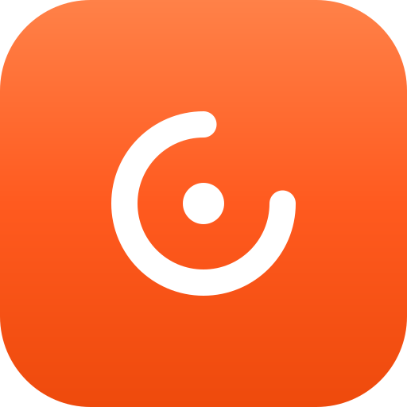
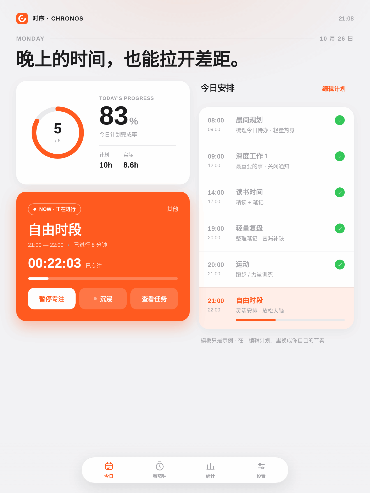
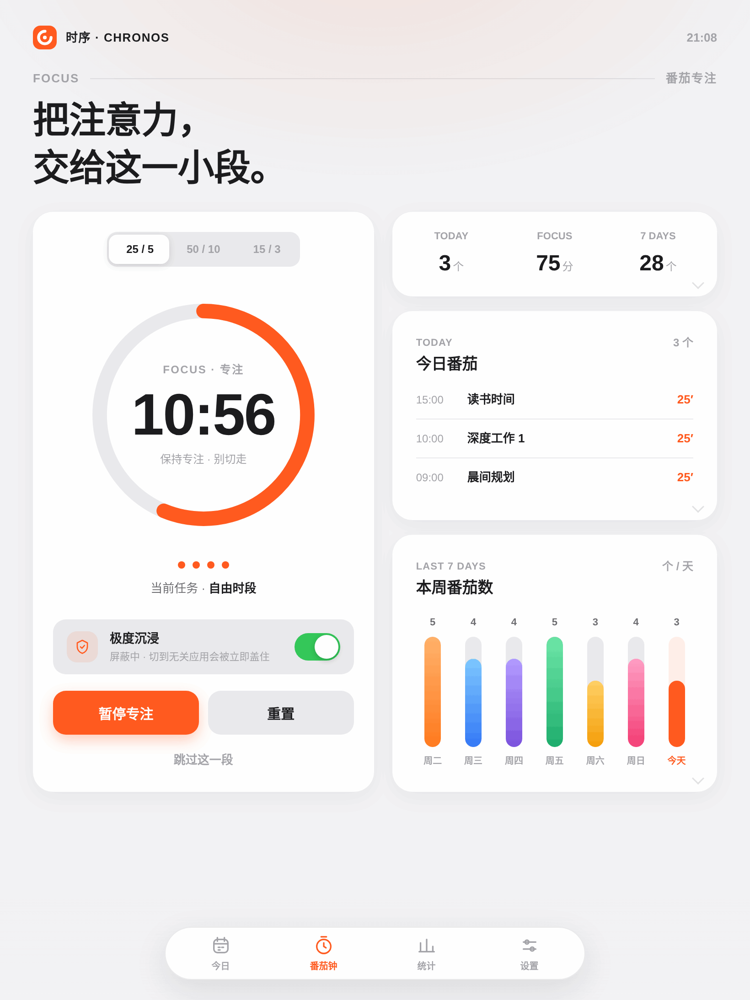
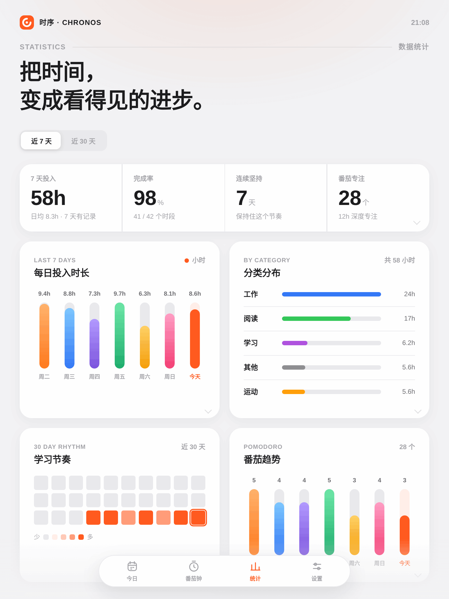

# 时序 · Chronos

<div align="center">



### 让每一段时间，都有明确的方向

为学习、工作与长期目标打造的本地优先时间管理应用。用计划确定方向，用专注完成当下，用复盘看见长期变化。

<p>
  <a href="https://github.com/Dvesiz/chronos/releases/latest/download/Chronos-2.7.7.apk"><strong>下载 Android APK</strong></a>
  ·
  <a href="https://dvesiz.github.io/chronos/app/"><strong>在线体验</strong></a>
  ·
  <a href="https://dvesiz.github.io/chronos/"><strong>产品官网</strong></a>
</p>

[](https://github.com/Dvesiz/chronos/releases/tag/v2.7.7)
[](https://github.com/Dvesiz/chronos/releases/latest)
[](https://github.com/Dvesiz/chronos/actions/workflows/pages.yml)
[](https://github.com/Dvesiz/chronos/actions/workflows/release.yml)
[](LICENSE)

</div>

<div align="center">





</div>

## 产品定位

Chronos 不只是一个待办清单。它把一天组织成可执行的时间段，让计划、专注、记录与复盘形成连续闭环：

```text
计划 Plan  ->  专注 Focus  ->  记录 Track  ->  复盘 Review
```

应用坚持三个原则：

- **本地优先**：不登录也能完整使用，网络不可用时不阻断计划、计时和统计。
- **低干扰**：界面只呈现完成当前时段所需要的信息，复杂能力在需要时出现。
- **长期可见**：保留每日投入、完成率、打卡、复盘和目标进度，让坚持有据可查。

## 核心体验

### 每日计划

- 用每日模板一次配置作息，自动生成当天时间轴。
- 支持延后、缩短、拆分、跳过、继续补时和临时增删。
- 未完成任务会在次日提示，可一键排入当天空档。
- 计划全部完成或跳过后显示每日打卡卡片，记录完成时段、专注时长和连续天数。

### 沉浸专注

- 番茄钟支持倒计时和正计时两种模式，可自定义时长并自动衔接休息。
- 任务计时独立于番茄钟，支持暂停、恢复和累计。
- 极简专注界面只保留时间、当前任务和必要操作。
- Android 极度沉浸模式可识别前台应用，离开 Chronos 时显示遮罩；闹钟、来电、紧急呼叫和授权弹窗会被放行。

### 数据统计

- 7 天和 30 天投入趋势、类别分布、完成率和计划对比。
- 月度打卡日历，结合当天投入强度查看长期节奏。
- 每日一句复盘、一键生成周报并分享。
- 周目标、连续天数、累计时长和番茄数等里程碑。

### Android 系统能力

- 精确到分钟的时段提醒，重启和时区变化后自动重建。
- 通知栏直接开始专注或稍后提醒。
- 2×2 桌面小组件显示今日进度、下一项任务和倒计时。
- 考试、答辩或项目截止日倒计时。
- 深色模式、横屏布局、安全区域和手机到平板的响应式适配。

## 平台能力

| 能力 | Android APK | 浏览器在线版 |
|:---|:---:|:---:|
| 计划、模板、专注、统计、打卡、复盘 | 支持 | 支持 |
| JSON 导入 / 导出 | 支持 | 支持 |
| 本地优先存储 | 支持 | 支持 |
| 邮箱登录与多设备同步 | 可选 | 可选 |
| 系统通知与精确提醒 | 支持 | 浏览器限制 |
| 桌面小组件 | 支持 | 不适用 |
| 极度沉浸与前台服务 | 支持 | 不适用 |

浏览器版直接复用 APK 的静态界面与核心逻辑，适合快速体验和跨设备使用。需要系统通知、精确闹钟、桌面小组件或极度沉浸时，请安装 Android APK。

## 下载与体验

### Android APK

[下载 Chronos 2.7.7](https://github.com/Dvesiz/chronos/releases/latest/download/Chronos-2.7.7.apk) · [查看全部 Releases](https://github.com/Dvesiz/chronos/releases)

Android 8.0 及以上可用。APK 不依赖 Gradle，安装后即可使用。首次从文件安装时，按系统提示允许当前文件管理器安装未知来源应用即可。

### 在线体验

[打开在线体验版](https://dvesiz.github.io/chronos/app/) · [打开产品官网](https://dvesiz.github.io/chronos/)

在线版的数据保存在当前浏览器中。清理浏览器站点数据前，请先使用应用内的「导出学习数据」保存 JSON 文件。

## 数据安全与同步

### 本地存储

Chronos 的业务状态以 IndexedDB 为主存储，数据库名为 `chronos-state-v1`。浏览器不支持 IndexedDB 或写入失败时，自动回退到 `localStorage`；Android 端还保留原生桥接备份。状态加载和保存都经过 schema migration，当前业务 schema 为 v3。

应用内的 JSON 导入导出始终可用。导入会覆盖当前业务状态，但在覆盖前会留存本机备份；卸载应用会清除本地数据，换机前请先导出。

### 可选云同步

登录邮箱验证码后，Chronos 可通过 Cloudflare Worker + D1 在 Android 和网页端同步计划、计时、统计与复盘。同步协议的关键保证包括：

- **账号作用域隔离**：事件、队列和云端文档绑定当前账号，切换账号不会串数据。
- **IndexedDB Outbox**：待同步事件写入独立的 `chronos-sync-v1` 队列，并保留 `localStorage` 兼容回退。
- **revision 与幂等账本**：服务端使用版本检查和事件幂等键，避免并发提交重复落库。
- **删除墓碑**：删除任务等实体会留下 tombstone，防止其他设备把已删除数据重新带回。
- **设备游标与安全归档**：设备确认同步游标后，服务端按活跃设备的最小确认位置归档旧事件。
- **快照与校验**：服务端维护带 revision、schema version 和 checksum 的快照，客户端可重新拉取并校验。
- **批量逐事件结果**：一次提交会返回每个事件的 accepted、conflict 或 rejected 状态，冲突事件保留在本地供处理。
- **网络恢复**：请求超时或断网时按 2 / 4 / 8 / 16 / 32 秒退避重试，不影响离线使用。

同步是可选能力。未登录、未配置 API 或网络不可用时，本地计划、计时、统计和 JSON 备份仍可正常工作。API 密钥只保存在 Worker Secret，不进入前端、APK 或仓库。

## 从源码开始

### 环境要求

- JDK 11 或更高版本；GitHub Actions 使用 JDK 17。
- Android SDK Platform 35。
- Android Build-Tools 35.0.0。
- Git Bash、WSL 或其他能运行 `build.sh` 的 Bash 环境。
- Node.js 运行测试和 Worker，本地部署依赖 Wrangler。

### 构建 APK

```bash
git clone https://github.com/Dvesiz/chronos.git
cd chronos
./build.sh
```

构建产物为 `build/Chronos-x.x.x.apk`。版本号只从 `app/src/main/AndroidManifest.xml` 的 `versionName` 读取，并在构建时同步到前端配置。

默认 SDK 路径为 `/opt/android-sdk`，也可以按需设置：

```bash
ANDROID_SDK=/path/to/android-sdk \
ANDROID_BUILD_TOOLS=/path/to/build-tools/35.0.0 \
ANDROID_JAR=/path/to/platforms/android-35/android.jar \
./build.sh
```

首次构建会生成本地 `keystore.jks` 和 `keystore.properties`，两者不会入库。升级现有 APK 时必须继续使用同一签名密钥。

### 运行测试

```bash
cd backend
npm ci
npm run test:all
```

测试覆盖前端状态迁移、主状态 IndexedDB、Outbox、Web Locks、多标签页同步、时间与统计逻辑，以及 Worker 的 revision、幂等、冲突、删除墓碑、设备游标和归档协议。

### 本地运行 Worker

```bash
cd backend
npm run dev
```

数据库迁移和部署命令见 [`backend/README.md`](backend/README.md)。生产发布使用 GitHub Actions：推送与 `AndroidManifest.xml` 版本一致的 `v*` tag 后，工作流会执行测试、构建签名 APK 并上传 GitHub Release。

## 技术结构

```text
chronos/
├── app/src/main/
│   ├── assets/www/                 # 无框架 HTML / CSS / JavaScript 核心应用
│   │   ├── app.js                  # 状态机、计划、计时、统计和页面交互
│   │   ├── cloud-sync.js           # 可选账号与多设备同步客户端
│   │   ├── browser-adapter.js      # 浏览器在线版适配
│   │   └── cloud-config.js         # 发布环境 API 配置
│   ├── java/com/dvesiz/chronos/
│   │   ├── MainActivity.java       # WebView 宿主、JS 桥和 edge-to-edge
│   │   ├── AlarmScheduler.java     # 提醒调度与错过补发
│   │   ├── ReminderReceiver.java   # 到点通知与通知操作
│   │   ├── FocusGuardService.java  # 极度沉浸前台服务
│   │   ├── ChronosWidgetProvider.java # 2×2 桌面小组件
│   │   └── BootReceiver.java       # 开机与时区变化后的提醒重建
│   └── res/                        # 图标、主题、通知和小组件资源
├── backend/                        # Cloudflare Worker + D1 API 与迁移
├── site/                           # 产品官网
├── tests/                          # 前端、同步协议和浏览器 E2E 测试
├── build.sh                        # aapt2 → javac → d8 → zipalign → apksigner
├── docs/img/                       # README 截图与品牌资源
└── LICENSE
```

项目刻意保持轻量：原生 Java + WebView、无 Gradle、前端无 React / Flutter / Compose，构建链路透明，核心业务逻辑可以在浏览器和 APK 之间复用。

## 版本记录

| 版本 | 主要变化 |
|:---|:---|
| **2.7.7** | 番茄钟加入正计时；完成平板设置页布局、安全区域和系统 inset 修复；同步状态 schema v3 与本地持久化收口。 |
| **2.7.0** | 接入 Cloudflare Worker + D1 邮箱验证码账号、多设备同步、反馈和版本检查；补齐 token 刷新超时保护。 |
| **2.6.x** | 完成在线体验版、数据导入导出、打卡卡片、复盘周报、目标与里程碑、桌面小组件、统计页和极度沉浸体验。 |
| **2.0.0** | 完成视觉系统重做，建立明亮极简设计语言与活力橙品牌色。 |
| **1.0.0** | 首个版本：模板日程、时间轴、专注计时和系统提醒。 |

## 参与贡献

欢迎通过 [Issue](https://github.com/Dvesiz/chronos/issues) 报告问题、提出建议，或提交 Pull Request。提交代码前请先运行 `cd backend && npm run test:all`，涉及界面时请同时验证手机和平板布局。

## 许可证

Chronos 采用 [MIT License](LICENSE)。你可以自由学习、修改和分发，欢迎 Star、Issue 与 Pull Request。

<div align="center">

**时序 · Chronos**

把今天安排好，把长期坚持留下来。

</div>
